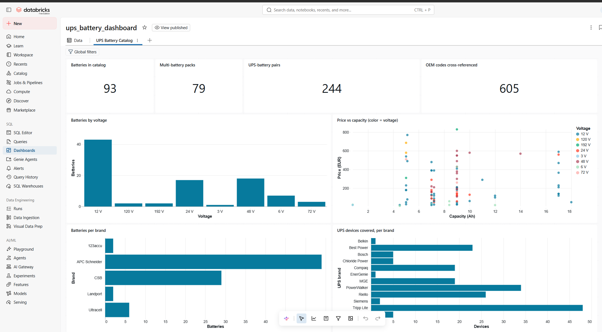
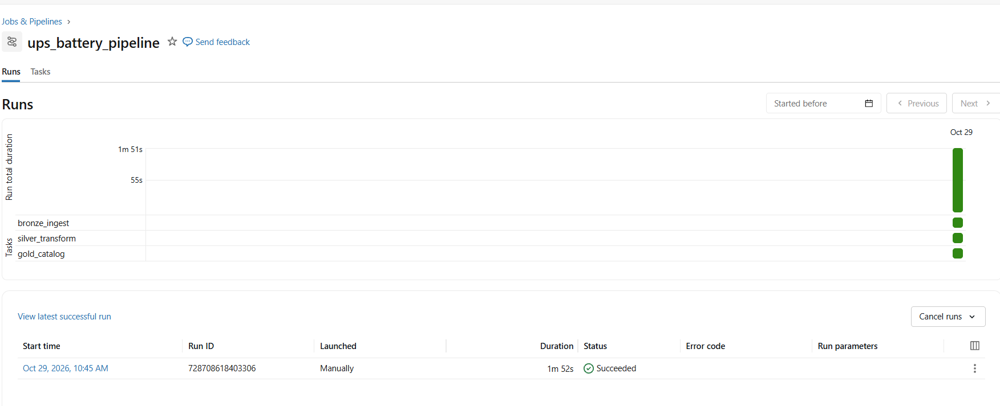

# UPS Battery Lakehouse

**Scrapy → Databricks**: a compatibility catalogue for UPS replacement batteries,
born from a real problem — my UPS died and finding a battery that *actually fits*
turned out to be absurdly hard. Shops list voltage and capacity, but compatibility
hides in the details nobody normalizes: dimensions, terminal types, pack
composition, OEM cross-reference codes.

This project scrapes a battery retailer politely, extracts specs from PDF
datasheets, and builds a governed lakehouse on **Databricks Free Edition** that
answers: *"my UPS needs a new battery — what do I buy?"*

```
Scrapy spiders (polite: robots.txt, 1 req, 3-7s delay, honest UA, HTTP cache)
      │   one timestamped JSONL per run  +  PDF datasheets → pdfplumber specs
      ▼
Unity Catalog Volume  /Volumes/ups_batteries/bronze/raw/{products,datasheets}
      │  01_bronze_ingest      COPY INTO (file-level idempotent increments)
      ▼
ups_batteries.bronze.{shop_raw, datasheets_raw}
      │  02_silver_transform   domain normalization + quarantine
      ▼
silver.{batteries, batteries_rejected, oem_equivalences, device_compat, datasheet_specs}
      │  03_gold_catalog       the compatibility product + validation
      ▼
gold.{battery_catalog, equivalence_groups, oem_lookup, device_lookup}
      │  04_price_scd2         price history as SCD Type 2 (MERGE INTO)
      ▼
AI/BI dashboard  (dashboard/ups_battery_dashboard.lvdash.json)
```

Orchestrated by a Databricks Job (`bronze → silver → gold`). Numbers from the
current crawl: **93 batteries** (45 of them multi-battery packs), **244
UPS-battery compatibility pairs**, **605 OEM cross-reference codes**, 2 PDF
datasheets parsed (11-12 fields each).

## The validation that matters

My APC Back-UPS 500VA takes a battery that is **151 × 51 × 94 mm**. Standard
12 V batteries of that capacity are **65 mm wide — they do not fit**, though
every naive V+Ah search recommends them (I know, I followed one). The Gold layer
encodes the rule *a candidate must be ≤ the bay in every dimension* and the
notebook **asserts** it against this real case:

> `VALIDATION PASSED — the naive V+Ah match would have offered 7 batteries
> that physically do not fit; the rule excluded all of them.`

Other domain normalizations the Silver layer handles:

- **Dutch number formats**: `"4.500 mAh"` = 4.5 Ah, `"4,5 Ah"` = 4.5 Ah
- **Terminal codes**: shops say T1/T2, datasheets say F1/F2 — same physical
  thing (4.8 mm / 6.35 mm faston) → unified
- **Pack arithmetic**: a 48 V replacement cartridge is 4 × 12 V batteries in
  series → `pack_units = voltage / 12`
- **APC RBC codes** extracted from titles; high-rate models' watts-per-cell
  parsed from part numbers (`HR1234W` → 34 W)
- ANSI-mode-safe casts (`nullif` before every regex→number cast)

## Engineering patterns demonstrated

| Pattern | Where |
|---|---|
| Incremental ingestion, file-level idempotence | `COPY INTO` in notebook 01 |
| Nested fields with spaces in Delta | column mapping on `bronze.shop_raw` |
| Quarantine data quality (7 rules, reasons kept) | notebook 02 |
| Many-to-many compatibility graph | `device_compat` edges emitted from listing pages |
| Regression-tested business rule | the dimension assert in notebook 03 |
| SCD Type 2 price history via `MERGE INTO` | notebook 04 (+ time travel `RESTORE`) |
| Respectful scraping under real-world pushback | see below |

## A note on respectful scraping

The spiders obey robots.txt, identify themselves honestly, run one request at a
time with 3–7 s randomized delays, and cache everything locally so re-runs never
re-hit the site. Midway through the crawl the retailer rate-limited us anyway
(HTTP 403, later an IP block on the section). We **stopped**, kept the ~2,000
pages already collected, documented the partial coverage, and did not attempt to
circumvent the block. The catalogue above is what polite crawling yielded —
which turned out to be plenty.

## Repository layout

```
scraper/             Scrapy project (2 spiders, layered parsing strategies),
                     PDF datasheet downloader + pdfplumber extractor,
                     cache-error purge utility
notebooks/           Databricks notebooks, importable source format
dashboard/           AI/BI dashboard as code (.lvdash.json)
docs/                validation cases (ground truth from my own UPS fleet)
sample/              small JSONL samples so the notebooks can be tried
tests/               pytest tests for the PDF spec extractor
```

## Run it yourself (Free Edition)

1. Free workspace: [databricks.com/learn/free-edition](https://www.databricks.com/learn/free-edition)
2. ```sql
   CREATE CATALOG IF NOT EXISTS ups_batteries;
   CREATE SCHEMA IF NOT EXISTS ups_batteries.bronze;
   CREATE SCHEMA IF NOT EXISTS ups_batteries.silver;
   CREATE SCHEMA IF NOT EXISTS ups_batteries.gold;
   CREATE VOLUME IF NOT EXISTS ups_batteries.bronze.raw;
   ```
3. Create `products/` and `datasheets/` directories in the volume and upload
   the sample JSONL files (or your own crawl output).
4. Import the notebooks, run 01 → 02 → 03 (04 is a self-contained SCD2 demo).
5. Import `dashboard/ups_battery_dashboard.lvdash.json` and publish.

To crawl fresh data: `cd scraper && pip install -r requirements.txt`, then
`scrapy crawl accu123 -a start_url=<UPS category URL> -a limit=10` (see the
spider docstrings), `python download_datasheets.py`, `python extract_datasheets.py`.

## Screenshots

| | |
|---|---|
|  |  |

## Known limitations / next steps

- How many batteries a UPS needs and their wiring is only partially derivable
  (pack voltage ÷ 12); APC RBC pack definitions would complete it.
- Datasheet coverage is small (the shop links few PDFs); fetching official
  CSB/Ultracell datasheets by part number is the natural extension.
- A second shop (price comparison), Lakeflow/DLT expectations, file-arrival
  trigger on the volume, Databricks Asset Bundles.

## Data note & AI disclosure

Scraped data belongs to its sources; only small samples ship here, for
reproducibility. Built in collaboration with **Claude (Anthropic)** as pair
programmer — openly, as in all my projects ([previous one](https://github.com/mmereu97/cinemateca-lakehouse)):
architecture, workflow and every line reviewed, run and validated by me.

## License

Code under the [MIT License](LICENSE). Data belongs to its respective owners.
